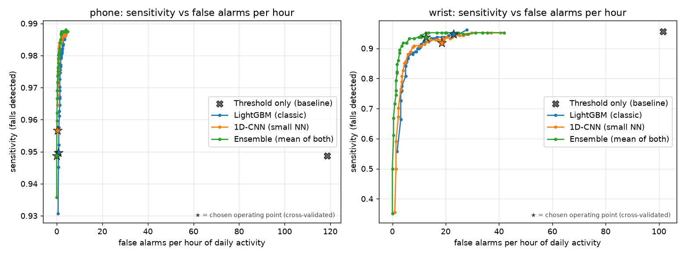

# FallGuard: fall detection from phone and wearable sensors

TheCarePal AI/ML internship assignment **AI-03**. A device-agnostic fall detector
that works with whatever the person has: a phone, a smartwatch or band, or both.
It runs entirely on the device and raises an alert with a 30-second "I'm OK" countdown
before a caregiver is notified.

> **Not a medical device.** This tool supports nurses and families. It does not
> diagnose anything or replace medical judgement, and every alert says so.

[](https://github.com/Nihit-Garg/theCarePal/actions/workflows/ci.yml)

**Live demo:** https://nihit-garg.github.io/theCarePal/ (works on a phone) · **Video:** _<add your video link>_

New here? Read [`docs/WALKTHROUGH.md`](docs/WALKTHROUGH.md), a guided tour of the code and every design decision.



## Results (people the model never saw)

<!-- RESULTS:START -->
Subject-wise nested 5-fold cross-validation: every number is on people the model never saw.
**False alarms per hour** are measured on lab daily-activity clips (dense bursts of jogging, hopping, clapping), so they are a pessimistic upper bound for a real, mostly quiet day.

**Phone**: 57 people (UMAFall pocket + SisFall waist), 2,006 falls, 16.8 h of daily activity

| Model | Sensitivity | Specificity | False alarms / hour | Falls caught |
|---|---|---|---|---|
| Threshold only (baseline) | 94.9% ± 0.5% | 65.0% ± 2.7% | 118.69 | 1903/2006 |
| LightGBM (classic) | 94.7% ± 2.6% | 99.6% ± 0.3% | 0.78 | 1899/2006 |
| 1D-CNN (small NN) | 95.6% ± 2.4% | 99.9% ± 0.1% | 0.30 | 1917/2006 |
| **Ensemble (shipped)** | 94.9% ± 2.9% | 100.0% ± 0.0% | 0.00 | 1903/2006 |

**Wearable (wrist)**: 19 people (UMAFall), 208 falls, 2.2 h of daily activity

| Model | Sensitivity | Specificity | False alarms / hour | Falls caught |
|---|---|---|---|---|
| Threshold only (baseline) | 95.7% ± 3.4% | 68.4% ± 5.1% | 101.49 | 199/208 |
| LightGBM (classic) | 93.8% ± 4.9% | 90.5% ± 2.6% | 23.00 | 195/208 |
| 1D-CNN (small NN) | 91.8% ± 6.8% | 93.1% ± 5.4% | 16.69 | 191/208 |
| **Ensemble (shipped)** | 94.2% ± 4.7% | 95.3% ± 3.3% | 11.28 | 196/208 |

**Both devices** (UMAFall's simultaneous phone + wrist recordings, held-out people):

| Strategy | Sensitivity | Specificity | False alarms / hour |
|---|---|---|---|
| Phone only | 97.1% | 99.6% | 0.90 |
| Wrist only | 95.7% | 93.3% | 16.24 |
| Either device (OR) | 99.5% | 93.1% | 16.70 |
| Both devices (AND) | 92.8% | 100.0% | 0.00 |
| **Mean of normalised scores (shipped)** | 95.7% | 99.8% | 0.45 |

What this says:
* The ML is what makes this usable: a plain impact threshold catches the same falls but fires **~100+ times per hour** on normal activity.
* The **ensemble has the fewest false alarms on both devices at comparable sensitivity**; the CNN and LightGBM make different mistakes. (On the phone, the CNN alone catches slightly more falls, 95.6% vs 94.9%, but with false alarms.)
* **The wrist is harder** (11/h): its remaining false alarms are mostly clapping, raising hands and lying down on a bed. Fusing it with a phone cuts that to 0.45/h at the same sensitivity.
* ⚠️ Only one person over 60 performed falls in these datasets (SisFall SE06), and the phone model caught 73% of their falls. Older people's falls may look different from young volunteers' simulated ones. This is the biggest open risk (see *Limitations*).
* **Battery** (estimate): ~0.19% per day on a phone, ~1.03% on a watch. Models are 231 KB, and inference takes ~0.15 ms on a laptop.
* **End-to-end test** (`npm run smoke`, headless Chrome at phone size): 6/6 held-out fall replays raise the alert, 0/11 everyday-activity replays do, and fallback switches correctly.
<!-- RESULTS:END -->

Full tables, including fold-to-fold spread, elderly subgroup and false alarms by
activity: [`reports/metrics.md`](reports/metrics.md) · fusion: [`reports/fusion.md`](reports/fusion.md)
· battery: [`reports/battery.md`](reports/battery.md).

## How it works

```
 any device ──► BinResampler ──► Stage 1: trigger ──► Stage 2: classifier ──► Fusion & ──► 30 s countdown ──► caregiver
 (phone, watch,   (any rate →     |a| ≥ T g and local   4 s window around     fallback      "I'm OK" cancels    webhook
  band, sim)       20 Hz)          max (always on,       the peak: LightGBM    (which device
                                   ~free)                + 1D-CNN ensemble     to trust)
```

1. **Harmonise.** Every source is bin-averaged into 20 Hz samples in g. 20 Hz is the
   lowest rate in the data, it is enough for fall dynamics, and it is cheap on battery.
2. **Stage 1, trigger.** A fall has an impact, so we only look closer when |a| crosses a
   per-device threshold (set so that ~99% of training falls pass) and is a local
   maximum. This runs on every sample and costs almost nothing.
3. **Stage 2, classify the moment.** We take a 4 s window: 1.5 s before the peak
   (free fall?) and 2.5 s after it (did they stay down?). It is converted to
   **orientation-invariant channels**: total acceleration, the parts along and across
   the pre-impact gravity direction, and tilt from the starting posture. Two models
   score it:
   * **LightGBM** on 20 interpretable features (impact peak, free-fall dip, stillness after
     the impact, change in posture, jerk…)
   * a **1D-CNN** (~6k parameters) on the 4 channels

   Their mean is the fall probability. It had the fewest false alarms on both devices at
   comparable sensitivity (see *Results*).
4. **Decide.** The alarm fires if the probability is at or above the device's threshold,
   with at most one alarm per 10 s.
5. **Fusion and fallback** (`web/src/engine/fusion.js`):
   * wearable connected, worn and streaming, plus a phone on the person → **fused**: each
     device's score is divided by its own threshold, and the alarm fires if the average is ≥ 1
   * wearable only → wearable model
   * otherwise the phone → phone model (with a warning if it looks like it was left on a table)
   * nothing → the UI says plainly that falls can't be detected right now
6. **Alert.** A full-screen alert shows a 30 s countdown, a large "I'm OK" button, and
   which device(s) detected the fall and how confident they were. If a wearable is worn,
   it also shows the **heart-rate change since the impact**. That is a supporting signal,
   never a gate: beta-blockers, which many older adults take, blunt the rise. If nobody
   cancels, or they press "Get help now", the caregiver message is sent (to a webhook if
   one is configured; otherwise it is shown).

### Key design decisions

| Decision | Why |
|---|---|
| **Device-agnostic, accelerometer-only** | Every phone and band has an accelerometer; many bands have no gyroscope. One code path covers Android, iPhone, Wear OS, Apple Watch and BLE bands. |
| **Orientation-invariant inputs** | The phone can be any way up in a pocket and the band strapped either way. The models never see raw x/y/z, so axis conventions don't matter. |
| **Two-stage detector** | Stage 1 rejects >99% of samples for free, so the ML runs only a few times per hour, which keeps the battery cost negligible. |
| **Wait 2.5 s after impact** | "Fell and stayed down" is what separates a fall from sitting down hard. The latency is still a few seconds. |
| **Subject-wise nested CV** | Random window splits put the same person in train and test and inflate results. Here thresholds are chosen on training people only, and test people are never seen. |
| **Event-level metrics on full streams** | Sensitivity, specificity and false alarms per hour come from running the real streaming detector over whole recordings, exactly as the product would. |
| **Sensitivity-first threshold (≥95% target)** | A false alarm costs one tap on "I'm OK"; a missed fall can mean a long time on the floor. The countdown is what makes a high-sensitivity operating point acceptable. |
| **Wrist as the wearable position** | It's where watches and bands are worn, and it's the hardest position (arms move a lot). We don't hide that: the wrist numbers are worse than the phone's. |
| **Runs in the browser (ONNX Runtime Web)** | No server, no cost, and no sensor data leaves the device. The same `.onnx` files run on Android, iOS and Wear OS through ONNX Runtime Mobile. |
| **Python and JS parity tests** | The browser re-implements the feature pipeline, so `npm test` checks it against golden vectors exported from Python (resampling, channels, features, ONNX outputs, streaming peaks). |

## Data

| Dataset | Used for | Subjects | Notes |
|---|---|---|---|
| [UMAFall](https://figshare.com/articles/dataset/UMA_ADL_FALL_Dataset_zip/4214283) (Casilari et al., 2017) | phone (right pocket, 200 Hz) **and wrist** (SensorTag, 20 Hz), recorded simultaneously | 19 | the simultaneous recording lets us evaluate fusion and replay synchronised streams |
| [SisFall](https://doi.org/10.3390/s17010198) (Sucerquia et al., 2017) | phone (waist device, 200 Hz, a proxy for a phone in a pocket or holster) | 38, **15 aged 60+** | adds ~14.5 h of daily activities, including elderly people's, for a realistic false-alarm rate |

Only public data is used. No real patient data, and none of TheCarePal's data.

## Run it

Requirements: Python 3.10–3.12, Node 18+, ~1 GB of disk.

```bash
# 1. Python environment (uv shown; plain venv + pip works too)
uv venv --python 3.12 .venv && uv pip install --python .venv -e "ml[dev]"

# 2. Data (~310 MB download, free)
bash ml/scripts/download_data.sh
.venv/bin/python ml/scripts/prepare_data.py

# 3. Evaluate (subject-wise nested CV, ~25 min on a laptop CPU) → reports/
.venv/bin/python ml/scripts/train_eval.py
.venv/bin/python ml/scripts/eval_fusion.py

# 4. Train the final models, export ONNX + demo replays + parity vectors → web/public, web/src/engine
.venv/bin/python ml/scripts/export_models.py
.venv/bin/python ml/scripts/battery_estimate.py

# 5. Web demo
cd web && npm install && npm test && npm run dev
# optional end-to-end check in headless Chrome: npm run build && npm run smoke

# Python unit tests + lint (no datasets needed)
cd ../ml && ../.venv/bin/python -m pytest -q && ../.venv/bin/ruff check .
```

The trained models and demo replays are committed, so **step 5 works on its own**.
To try the real phone sensor, open the dev server's network URL on your phone (it
needs HTTPS for motion sensors, so use the deployed version or a tunnel) and pick
**Phone → This phone**.

Optional: copy `web/.env.example` to `web/.env` and set `VITE_ALERT_WEBHOOK_URL` to POST
alerts (for example to a Firebase Cloud Function that notifies the nurse app).

### Using the demo
* **Devices:** connect or disconnect the wearable, take it off, switch the phone between
  simulated, this phone's sensor and off, or leave it on a table. The pill at the top
  shows which sensor is being trusted.
* **Scenarios:** the stream plays a "normal day" of everyday activities. Tap a fall to
  inject it. Tap "Lying down on a bed" or "Clapping" to see the hard cases the model
  has to reject.
* The chart shows |a| for each device, with each stage-2 score next to its peak.

## Repository layout

```
ml/fallguard/        datasets.py  signal.py  detector.py  models.py  evaluate.py  fusion.py
ml/scripts/          download_data.sh  prepare_data.py  train_eval.py  eval_fusion.py
                     export_models.py  battery_estimate.py
web/src/engine/      resample.js  signal.js  detector.js  model.js  fusion.js  engine.js
                     sim.js  livePhone.js  notify.js  parity.test.js
web/src/components/  SignalChart.jsx  AlertOverlay.jsx
web/public/models/   *.onnx  model_config.json
web/public/replays/  synchronised phone + wrist recordings of the held-out demo subjects
reports/             metrics.md  fusion.md  battery.md  figures/
ml/tests/           unit tests (incl. random-rotation orientation-invariance test)
.github/workflows/   ci.yml (lint, tests, parity, build, headless smoke) · pages.yml (deploy demo)
docs/WALKTHROUGH.md  guided tour of the code · docs/VIDEO_SCRIPT.md · docs/real-devices.md
```

## Assumptions and limitations

* **Lab data ≠ real life.** Falls were simulated by young volunteers onto mats; the
  everyday activities are short, dense bursts. False alarms per hour measured this way are a
  pessimistic upper bound, and the sensitivity on real elderly falls is unknown. Those are
  slower, and some happen from sitting or lying.
* **Wrist data is limited** (19 people, 2.2 h of everyday activity), so the wrist numbers
  have wide error bars (see the ± in the tables).
* **SisFall's waist device stands in for a phone in a pocket.** Both sit near the hips, but
  a phone in a loose pocket moves more.
* **Heart rate is simulated.** None of the public fall datasets record it. The
  confirmation logic (rise vs the 30 s pre-impact baseline) is real; the signal isn't.
* **Browsers pause sensors when the screen is off**, so a production phone app must be native.
  See `docs/real-devices.md`.
* SisFall's original host is offline; the download script uses a public mirror of the
  unmodified release (file layout and units checked against the paper).

## What I'd build next

1. **Native apps** (Android and Wear OS first, since most of TheCarePal's families likely use
   Android) running the same ONNX models in a background service, with watch-side inference.
2. **Firebase integration**: alert → Cloud Function → Firestore incident + FCM push to the
   assigned nurse and family, escalating to a phone call if nobody acknowledges in N minutes.
   Incidents show up in the ops CRM.
3. **Learn from cancellations**: every "I'm OK" is a labelled false alarm. With consent, use
   them to tune thresholds per person (someone with a vigorous gait gets a different
   operating point).
4. **Longer real-world validation**: wear-test with staff and volunteers for full days to
   measure true false alarms per day, and evaluate on real-fall data (for example FARSEEING)
   if access can be arranged.
5. **Long-lie and inactivity detection**: no movement for N minutes at night when there is
   normally movement. That catches falls with soft impacts that stage 1 misses.
6. Quantise the models (int8) and add a TFLite export for teams that standardise on it.

## Cost to run

| Component | Cost |
|---|---|
| Datasets (UMAFall, SisFall) | free, public |
| Python libraries (NumPy, pandas, scikit-learn, LightGBM, PyTorch, ONNX, onnxmltools) | free, open source |
| Training | ~25 min CPU for the full evaluation, ~3 min for the final models; no GPU needed |
| Inference | on the user's device (ONNX Runtime Web/Mobile, free); **no server or API cost per user** |
| Hosting the demo | free static hosting (GitHub Pages / Vercel / Firebase Hosting) |
| Webhook (optional) | Firebase Cloud Functions free tier covers a pilot |

No paid model APIs are used.

## AI tools used

* **Claude (Claude Code)** was my pair-programmer. I used it to discuss the approach,
  scaffold the code, write the JS port of the signal pipeline and the parity tests, and
  draft this README. I reviewed, ran and can explain every part. The design choices (subject-wise
  nested CV, event-level metrics, orientation-invariant channels, two-stage detection,
  sensitivity-first operating point, data-driven fusion rule) are explained above and in the video.
